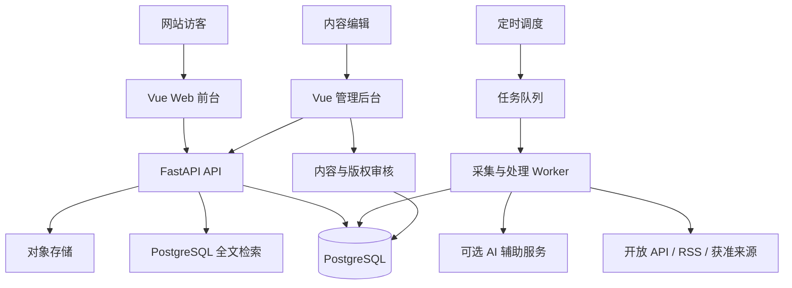

# 系统架构设计

- 文档状态：Draft
- 版本：0.1

## 1. 架构目标

采用模块化单体 + 独立采集 Worker 的初始架构。先保证数据治理、审核和来源可追溯，再逐步扩展采集规模和媒体能力。首期不采用微服务。

## 2. 逻辑架构

## 3. 技术选型

| 组件 | 初始方案 | 说明 |
| --- | --- | --- |
| Web | Vue 3 + TypeScript + Vite | 前台与后台可共享组件 |
| API | FastAPI + Pydantic | REST API、数据校验 |
| DB | PostgreSQL | 关系数据、JSONB、全文检索 |
| Ingestion | Python + HTTPX | API、RSS、允许访问的网页 |
| Parsing | BeautifulSoup / feedparser | 仅处理符合来源规则的内容 |
| Queue | Celery + Redis | 任务量上升后启用 |
| Media | S3-compatible storage | 仅存储具有明确使用权的媒体 |
| Deploy | Docker Compose + Nginx | 单机部署起步 |

## 4. 业务模块边界

- catalog：作品、作者、分类、标签、作品关系。
- content：作品正文、翻译、注释和版本。
- sources：信源、来源条目、采集策略。
- ingestion：采集任务、解析器、标准化、去重。
- rights：版权记录、许可证、证据和适用地域。
- review：人工审核、退回意见、审核历史。
- media：图片、音频及其他媒体资产。
- publishing：公开状态、发布与下架。
- search：统一检索与筛选。

## 5. 数据流

1. 信源配置进入采集调度。
2. 采集器按来源允许的方式读取目录或内容。
3. 原始响应按来源策略保留必要的审计信息，不无差别归档受保护内容。
4. 标准化生成作品候选及来源条目。
5. 去重模块匹配现有作品，无法确定时交由人工处理。
6. AI 可生成标签、摘要草稿和质量提示。
7. 权利审核与内容审核分别执行。
8. 只有满足发布条件的作品才进入公开查询。
9. 下架或授权到期时，公开接口立即停止返回相关内容。

## 6. 安全边界

- API 密钥、对象存储密钥和数据库密码只从环境变量或密钥管理服务读取。
- 管理端与公开 API 分离权限。
- 公开 API 只查询已发布且权利状态满足发布策略的数据。
- 采集器设置超时、速率限制、重试上限和域名白名单。
- 禁止绕过登录、付费墙、验证码、访问控制或明确的反自动化限制。
- 上传媒体进行类型、大小和恶意文件检查。
- 管理操作写入审计日志。

## 7. 部署拓扑

MVP 可在一台服务器上运行：
- nginx
- frontend
- api
- PostgreSQL
- Redis（启用异步任务时）
- ingestion-worker
- 对象存储使用外部 S3 服务或本地开发替代方案

生产环境应单独备份数据库和媒体元数据，并定期验证恢复流程。

## 8. 可演进方向

- 数据量增加后，将搜索迁移到 Meilisearch / OpenSearch。
- 采集任务增加优先级、来源配额和失败隔离。
- 媒体资源增加转码与 CDN。
- 将 AI 处理抽象为可替换 Provider。
- 当模块边界和规模确有需要时再拆分服务。
