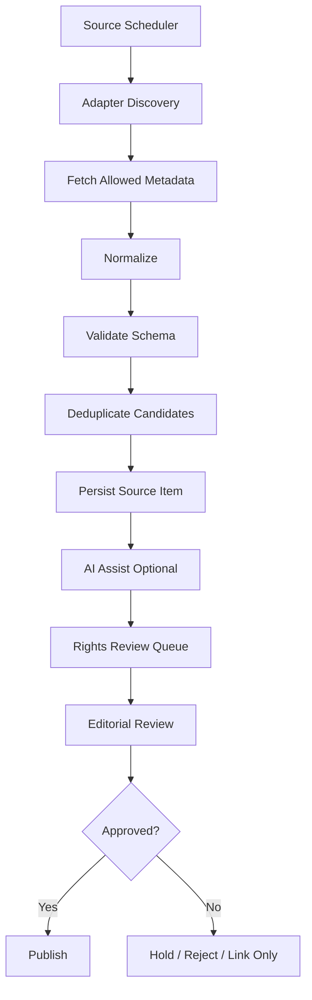

# 自动采集系统设计

- 文档状态：Draft
- 版本：0.1

## 1. 目标

建立可配置、可审计、可暂停的采集管道，将获准来源的作品目录或内容元数据转换为统一作品候选，交由版权和内容审核流程处理。

## 2. 支持的接入方式

按优先级：
1. 官方 API / 官方数据导出。
2. 开放数据集、开放目录及许可明确的数据源。
3. RSS / Atom。
4. 站点明确允许且符合其条款的公开页面解析。
5. 人工导入 CSV / JSON。

不实现登录态抓取、付费墙绕过、验证码绕过、访问控制绕过或规避反自动化措施。

## 3. 采集适配器接口

每个来源实现独立 Adapter，建议接口：
- validate_config()
- discover(cursor)
- fetch(item_reference)
- normalize(raw_record)
- get_policy_metadata()
- health_check()

Adapter 输出统一的 NormalizedSourceItem，不直接发布作品。

## 4. 标准化管道

## 5. 任务状态

- queued
- running
- succeeded
- partially_succeeded
- retrying
- failed
- paused
- cancelled

任务记录来源、开始和结束时间、采集数量、跳过数量、错误摘要、运行版本及配置快照。

## 6. 调度与可靠性

- 来源级启停开关。
- 每个来源独立的并发数与请求速率。
- 连接与读取超时。
- 有上限的指数退避重试。
- 幂等写入，避免重复创建来源条目。
- 游标 / 时间窗口增量采集。
- 失败队列与人工重试。
- 采集任务与前台 API 隔离。

MVP 可以先使用命令行任务和简单定时调度，确认需要后再引入 Celery + Redis。

## 7. AI 辅助边界

允许：
- 分类与标签建议。
- 作者候选匹配。
- 摘要草稿。
- 字段缺失和格式异常检测。
- 重复候选提示。
- 适龄编辑建议。

禁止：
- 自动断言作品为公版或已获授权。
- 将版权不明的作品改写后直接发布。
- 未经许可生成或复制完整歌词、故事正文、插画或录音。
- 未经人工审核直接改变发布状态。

AI 输出必须记录模型、提示模板版本、输入来源引用和生成时间。

## 8. 质量检查

- 必填字段完整性。
- 作者与作品关联一致性。
- 语言和字符编码检查。
- 诗词行数、章节顺序等格式检查（只做提示，不自动改写原文）。
- URL 可用性检查，遵守来源速率限制。
- 内容哈希与近似重复提示。
- 来源及版权证据完整性。

## 9. 监控指标

- 每个来源发现条目数。
- 成功 / 失败任务数。
- 解析成功率。
- 重复候选率。
- 待版权审核数量。
- 待内容审核数量。
- 平均审核耗时。
- 外链失效率。

## 10. MVP 交付顺序

1. 定义 Source / SourceItem / IngestionTask 数据模型。
2. 实现手动 JSON / CSV 导入。
3. 实现一个许可明确的开放目录 Adapter。
4. 加入标准化、幂等和任务日志。
5. 建立人工审核队列。
6. 再扩展其他来源和 AI 辅助。
