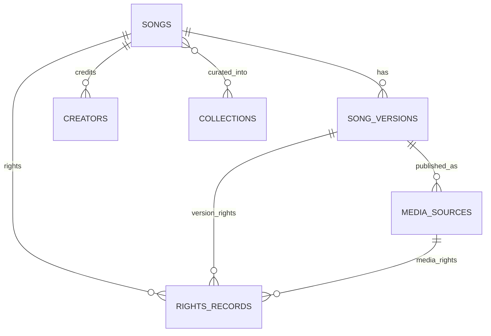
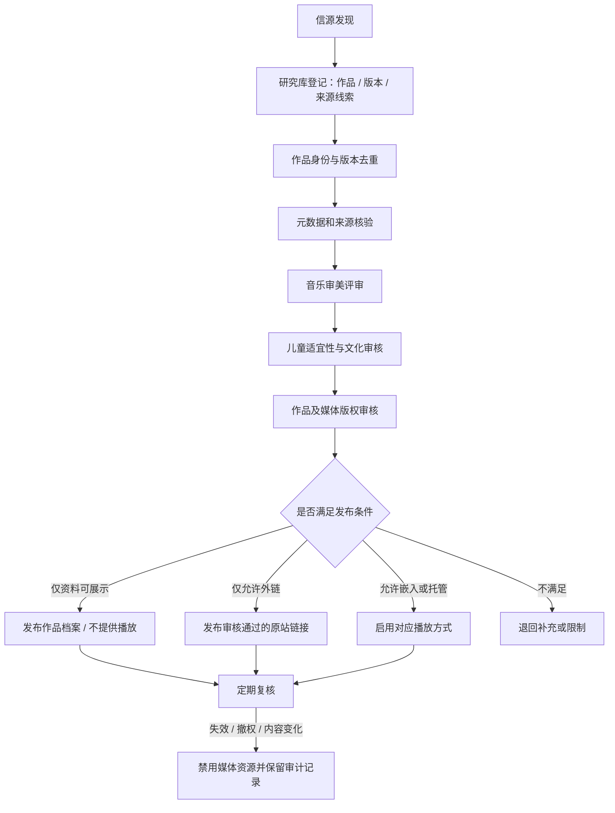

# 儿童经典音乐图书馆建设方案

> **Childhood Library · Music Library**
>
> 版本：v1.0  
> 状态：产品与内容规划基线（**历史扩展版**，内容保留；当前产品定位基准以 `MUSIC_LIBRARY_V1.md` 为准，统一入口见 `MUSIC_LIBRARY_MASTER_PLAN.md`）  
> 更新日期：2026-11-18  
> 定位：以中国经典为根，以世界经典为窗，以优秀原创为未来。

---

## 1. 项目愿景

Childhood Library 不做以歌曲数量、播放时长或短视频热度为目标的普通儿歌播放器，而是建设一座**有审美标准、有文化背景、有来源依据、能够长期积累的儿童经典音乐图书馆**。项目将研究发现、资源整理和公开传播分层管理：研究阶段允许记录尚未核实权利的作品与公开来源线索；进入对外展示或播放环节时，再根据具体内容和使用方式核实权利。

我们希望孩子听到的不只是“热闹”“洗脑”或高密度刺激，也能听见自然、优美、安静、幽默、诗意和富有想象力的声音。

### 1.1 音乐定位

**以中国经典为根，以世界经典为窗，以优秀原创为未来。**

- 中国经典是首期建设重点，优先挖掘经典儿童歌曲、地方童谣、民歌、摇篮曲、校园歌曲与古诗词音乐。
- 世界经典帮助孩子接触不同语言、地域和文化中的童年音乐。
- 优秀原创面向当代创作者，给真正尊重儿童、尊重音乐的作品留下空间。

### 1.2 项目不做什么

- 不以短视频热度、洗脑程度或强刺激作为选曲标准。
- 不把所有适合成年人怀旧的歌曲都归为幼儿歌曲。
- 不把“网上能播放”理解为“可以转载、下载、缓存或嵌入”。
- 不因版权信息暂时未知，就拒绝把作品或公开页面作为研究候选登记。
- 不通过抓取、下载或镜像第三方平台音视频来快速填充曲库。
- 不以自动化模型代替编辑判断、版权审核和儿童内容审核。

## 2. 核心内容结构

首期资源建设精力建议按以下比例投入。比例是建设资源分配，不是对音乐价值的排名。

| 内容支柱 | 首期投入建议 | 主要内容 |
|---|---:|---|
| 中国经典 | 55% | 经典儿歌、传统童谣、地方民歌、摇篮曲、校园歌曲、诗词音乐 |
| 世界经典 | 30% | 世界童谣、摇篮曲、儿童歌曲、民族音乐、儿童古典音乐 |
| 优秀原创 | 15% | 当代原创、独立音乐人、自然主题、儿童音乐启蒙作品 |

### 2.1 内容地图

| 专题 | 内容范围 | 编辑关注点 |
|---|---|---|
| 童年的歌 | 中国经典儿童歌曲、校园歌曲、童年记忆 | 区分儿童歌曲、校园歌曲与成人怀旧作品 |
| 大自然的歌 | 春夏秋冬、花草树木、鸟兽、河流海洋 | 自然观察、画面感与旋律舒展度 |
| 游戏与伙伴 | 游戏歌、拍手歌、数数歌、问答歌 | 互动性、语言趣味与传统玩法 |
| 月亮与摇篮曲 | 中国及世界各地摇篮曲、安睡音乐 | 温柔、克制、适合陪伴，不承诺助眠效果 |
| 古典音乐的童年 | 儿童古典作品、适龄器乐小品、音乐故事 | 引导聆听，不把作品简化成“训练工具” |
| 世界的童谣 | 多语言童谣、地方儿童歌曲、民族音乐 | 保留原语言、文化背景和地域版本 |
| 被遗忘的童谣 | 地方方言、口传童谣、历史采录 | 记录传承人、采录地点、异文和语境 |
| 新芽原创 | 当代原创儿童音乐 | 尊重儿童视角、创作质量与明确授权 |

专题可以多选；专题分类不替代作品类型、地区、语言和年代等基础字段。

## 3. 音乐审美与编辑准则

**优美、自然、童真、耐听**是音乐馆的四个核心关键词。

| 评审维度 | 观察问题 | 正向特征 | 需要谨慎的情况 |
|---|---|---|---|
| 旋律美感 | 旋律是否自然、优美、有记忆点？ | 旋律线清晰、动机自然、便于哼唱 | 只靠重复片段或音效制造记忆 |
| 童真表达 | 是否尊重儿童的感受和想象？ | 好奇、游戏、自然观察、真实情感 | 成人化表达、刻意卖萌、低幼化说教 |
| 歌词文学性 | 是否有画面、故事和语言趣味？ | 具体意象、节奏韵律、想象空间 | 空洞口号、机械重复、表达不适龄 |
| 音乐品质 | 演唱、编曲、音色是否协调？ | 清晰演唱、适度编配、自然音色 | 过度压缩、刺耳音效、密集刺激 |
| 文化价值 | 是否有历史、地域或艺术价值？ | 来源可考、文化脉络清楚 | 背景传说未经证实、文化标签失真 |
| 耐听程度 | 多次聆听是否仍有吸引力？ | 经得起重复聆听、细节有层次 | 依赖突发音效或强刺激 |
| 年龄适宜性 | 对应年龄是否容易理解和接受？ | 内容、表达、时长与场景适宜 | 恐吓、危险模仿、歧视或不当表达 |

### 3.1 编曲与音色偏好

优先关注钢琴、木吉他、木琴、长笛、弦乐、口琴及民族乐器等自然、清晰的音色；也欢迎制作精良的现代编曲。

这不是“传统乐器一定好、电子乐一定差”的简单判断。评审重点是编曲是否服务于旋律和表达，是否存在不必要的高密度刺激。

### 3.2 编辑原则

1. 童真不等于幼稚；儿童音乐也可以安静、深情、幽默或略带忧伤。
2. 简单不等于粗糙；旋律易记不代表作品缺少艺术性。
3. 不以刺激性作为吸引力，不以重复性作为记忆力，不以热度作为艺术价值。
4. 允许现代创作与现代编曲，但要求尊重儿童视角和音乐品质。
5. 不做机械总分榜；采用编辑评语、专题策展和多维标签说明收录理由。

## 4. 中国经典优先建设计划

中国部分是首期重点，但不应只围绕少数耳熟能详的创作儿歌。应同时保存城市与乡村、普通话与方言、创作歌曲与口传童谣的多样性。

| 子专题 | 候选方向 | 建设任务 |
|---|---|---|
| 经典儿童歌曲 | 《让我们荡起双桨》《小燕子》《我们的田野》等 | 核实词曲作者、创作背景和不同录音版本 |
| 传统童谣 | 摇篮曲、数数歌、问答歌、游戏歌 | 按地区、方言、采录版本建立档案 |
| 校园与童年 | 《外婆的澎湖湾》《童年》等 | 明确歌曲定位，不一概标为幼儿儿歌 |
| 自然与四季 | 《春天在哪里》《小螺号》等 | 关注自然意象和旋律品质 |
| 古诗词音乐 | 《春晓》《静夜思》等谱曲版本 | 诗词作品与具体谱曲、演唱版本分开记录 |
| 民族与地方音乐 | 各地民歌、地方小调、民族器乐 | 补充地域、语言、文化语境与版本信息 |
| 被遗忘的童谣 | 北京、闽南、绍兴及其他地方童谣 | 寻找非遗档案、地方志、采录出版物和传承人资料 |

> 上表中的作品是研究候选，不代表已完成作品考证、适龄审核或播放授权。对同名作品、地方异文和现代改编必须分别建档。

## 5. 世界经典建设计划

世界音乐不是简单翻译英文儿歌。应尽可能保留原语言、发音、文化背景和不同地区的版本。

| 地区 | 重点方向 | 研究示例 |
|---|---|---|
| 英国 | 传统童谣、游戏歌、数数歌 | Twinkle, Twinkle, Little Star；London Bridge Is Falling Down |
| 美国 | 民间歌曲、自然主题、传统儿童歌曲 | You Are My Sunshine；Home on the Range |
| 法国 | 传统童谣、儿童歌曲 | Frère Jacques |
| 德国 | 摇篮曲、古典儿童音乐 | Brahms' Lullaby |
| 日本 | 童谣、四季歌曲 | 七つの子；赤とんぼ |
| 意大利 | 民歌、传统旋律 | 传统歌曲与儿童音乐专题 |
| 俄罗斯及东欧 | 民间童谣、摇篮曲、合唱 | 按具体国家和语言逐项研究 |
| 世界其他地区 | 非洲、拉美、南亚、东南亚及大洋洲 | 以可靠文化档案和当地来源为主 |

研究示例仅用于发现作品，不构成对具体歌词、译词、录音或视频的使用许可。跨文化内容应避免把单一版本说成整个国家或民族的唯一传统。

## 6. 古典音乐与儿童聆听

古典音乐专题的目标是提供适合儿童接触的音乐入口，而不是把儿童聆听等同于智力训练或效果承诺。

| 作曲家 | 研究方向 | 示例 |
|---|---|---|
| 罗伯特·舒曼 | 钢琴小品、儿童视角 | 《童年情景》及《梦幻曲》 |
| 卡米尔·圣-桑 | 乐器音色与动物形象 | 《动物狂欢节》 |
| 沃尔夫冈·阿马德乌斯·莫扎特 | 歌剧、室内乐、明朗旋律 | 选择适宜片段并提供聆听导读 |
| 爱德华·格里格 | 自然意象与管弦乐色彩 | 选择适龄器乐作品 |
| 约翰内斯·勃拉姆斯 | 摇篮曲与抒情旋律 | 《摇篮曲》不同演唱和演奏版本 |

每个作品应提供“听什么”的简短导读，例如辨认乐器、感受旋律变化、想象音乐画面；避免过度讲解或把聆听变成考试。

## 7. 年龄与场景导航

年龄仅作为内容发现的参考，不构成能力判断或强制限制。

| 推荐年龄 | 内容方向 | 页面体验 |
|---|---|---|
| 0–2 岁 | 温柔摇篮曲、亲子哼唱、简单旋律、自然音色 | 简洁封面、低干扰操作、明确播放状态 |
| 2–4 岁 | 动物、自然、游戏歌、简单童谣 | 图像化主题、亲子互动提示 |
| 4–6 岁 | 故事歌曲、传统童谣、合唱、音乐游戏 | 歌曲故事、简单文化介绍 |
| 6–12 岁 | 古典音乐、民族音乐、校园经典、世界音乐 | 作曲家、地域、乐器与历史导读 |

场景入口可包括：一起唱、安静听、自然观察、音乐游戏、认识乐器、听听世界。不得将音乐宣传为医疗、睡眠或发育治疗手段。

## 8. 首批 100 首种子库计划

第一阶段目标是建立 **100 首高质量候选作品档案**，不是承诺 100 首均可立即播放。

| 内容支柱 | 目标数量 | 说明 |
|---|---:|---|
| 中国经典 | 55 | 创作儿歌、传统童谣、地方歌谣、诗词音乐等 |
| 世界经典 | 30 | 多语言童谣、摇篮曲、儿童古典音乐等 |
| 优秀原创 | 15 | 通过编辑评审且授权路径清楚的原创作品 |
| **合计** | **100** | 候选数量与已授权播放数量分别统计 |

### 8.1 每首作品的采集卡

- 稳定作品 ID、规范标题、别名和语言。
- 国家/地区、地方文化或方言信息。
- 作品类型、主题、建议年龄与使用场景。
- 作词、作曲、编曲、演唱者及其他创作者（有可靠来源时）。
- 创作年代、首次发表或采录信息（有证据时）。
- 作品背景、文化语境和编辑推荐理由。
- 可信来源、来源 URL、访问日期和证据说明。
- 不同歌词、旋律、译词、改编和录音版本的关系。
- 作品权利、录音权利、视频权利和播放许可状态。
- 内容审核状态、审核人、复核日期和变更记录。

### 8.2 质量门槛

候选进入目录后，依次完成：
1. 作品身份和版本去重。
2. 来源可信度与基础元数据核验。
3. 音乐审美评审。
4. 儿童适宜性评审。
5. 文化背景与表述核验。
6. 版权与播放方式审核。
7. 发布前人工复核。

## 9. 信源体系与研究方法

信源按“文化发现—作品考证—专业研究—版本发现—原创合作”组织。层级表示用途，不代表任何来源的内容天然拥有再利用许可。

| 层级 | 信源类型 | 主要用途 | 使用边界 |
|---|---|---|---|
| L1 文化档案 | 非遗中心、地方文化馆、地方志、博物馆 | 发现地方童谣、传承脉络、地域异文 | 记录出处；不默认复制音视频 |
| L2 图书与历史档案 | 国家图书馆、公共图书馆、历史录音档案 | 作品书目、出版信息、历史版本 | 逐项核实数字对象权利说明 |
| L3 专业研究 | 音乐学院、出版社、学术论文、作曲家资料 | 词曲作者、创作背景、音乐分析 | 区分研究观点与可证实事实 |
| L4 官方播放来源 | 权利人官网、唱片公司、官方账号、音乐平台 | 发现具体录音和视频版本 | 外链、嵌入、托管分别审核 |
| L5 原创与社区 | 独立音乐人、合唱团、地方传承人、投稿者 | 发现新作品和口传资料 | 取得清晰、书面、可追溯授权 |

### 9.1 首批研究入口

- [中国非物质文化遗产网](https://www.ihchina.cn/)：地方童谣、传统音乐和非遗项目线索。
- [中国国家图书馆](https://www.nlc.cn/)：书目、出版物和文献线索。
- [中国作家网](https://www.chinawriter.com.cn/)：儿童文学、歌词作者和作品背景线索。
- [美国国会图书馆](https://www.loc.gov/)：儿童歌曲、历史录音与文化档案。
- [Smithsonian Folkways](https://folkways.si.edu/)：世界民族音乐与文化录音研究。
- [Internet Archive](https://archive.org/)：历史资料发现；必须逐项检查权利与访问条件。
- [Bilibili](https://www.bilibili.com/) 等平台：发现具体版本和官方发布者，不将平台可播放等同于版权许可。

所有来源在启用采集前，必须检查官方 API、服务条款、自动访问政策、许可范围和作品级权利声明。

## 10. 作品、版本、媒体资源与版权模型

**核心原则：歌曲作品不是某一个视频，也不是某一份录音。**

一首作品可能对应多个演唱版本；一个版本也可能出现在多个平台。作品资料、录音资料和播放资源必须分离。

建议的核心实体：

| 实体 | 责任 |
|---|---|
| songs / works | 作品身份、标题、主题、地区、语言、文化背景 |
| creators | 作词、作曲、编曲、演唱、采录、传承人等 |
| song_versions | 具体演唱、演奏、译配、改编和录音版本 |
| media_sources | 外部链接、官方嵌入、授权音频文件等播放资源 |
| rights_records | 作品、译词、编曲、表演、录音、视频素材的权利记录 |
| collections | 专题策展、编辑精选和年龄/场景导航 |
| source_records | 资料来源、证据、核验日期与采集过程 |
| review_records | 音乐质量、儿童适宜性、事实与版权审核轨迹 |

### 10.2 面向公开资源的权利状态

研究库的研究状态与权利状态分开记录。以下状态用于作品、版本或媒体资源的权利判断，不用于阻止研究线索登记。

建议使用明确的状态机：

| 状态 | 含义 | 对外行为 |
|---|---|---|
| candidate | 候选，尚未完成核验 | 不公开播放 |
| metadata_verified | 基础元数据已核实 | 可按政策展示资料 |
| rights_pending | 权利待核验 | 不嵌入、不托管 |
| link_only | 仅允许展示经审核的原始来源链接 | 只提供外链 |
| authorized | 已取得覆盖目标使用方式的授权 | 按授权范围播放 |
| public_domain_verified | 已逐项核实相关作品及具体录音/表演等权利 | 按核验结论使用 |
| restricted | 禁止或授权范围不适用 | 不提供播放 |
| revoked | 授权撤回或权利状态变化 | 立即禁用相关媒体 |

公有领域判断必须结合发布地域、作者身份与死亡时间、作品类型、首次发表情况以及录音、表演、译词、编曲和视频等独立权利。不得只凭歌曲年代判断。

### 10.3 三种播放方式

| 方式 | 说明 | 启用条件 |
|---|---|---|
| 原站外链 | 跳转至权利人或平台原始页面 | 来源可信、链接政策允许、内容适宜 |
| 官方嵌入 | 使用平台提供的正规播放器 | 具体资源权利清晰，平台规则允许站外嵌入 |
| 站内托管 | 自己存储和播放音频/视频 | 已取得覆盖目标地域、用途、期限和传播方式的必要权利 |

Bilibili 等平台提供 iframe 技术能力，不代表 UP 主或平台已经授予该视频涉及的词曲、表演、录音和视听作品的站外传播许可。不得下载、代理、缓存或重新分发第三方视频来绕开平台机制。

### 10.4 第三方播放器的儿童体验

- 默认不自动播放。
- 关闭弹幕和非必要互动（在平台允许且技术可行时）。
- 点击后再加载第三方播放器，减少不必要的第三方脚本请求。
- 明确标记第三方来源，并提供原站入口。
- 检查广告、推荐内容、评论区、登录要求、地域限制和隐私行为。
- 嵌入失败时回退到原站链接或不显示播放入口。
- 资源下架、授权撤回或内容变化时，能够独立禁用媒体资源。

## 10.1 研究库与儿童音乐馆：双层资源体系

本项目明确区分**音乐研究库（Research）**和**儿童音乐馆（Library）**。两者共享作品、版本和来源数据，但面向不同角色，采用不同的展示与使用规则。

### 音乐研究库 Research

用于编辑、研究人员和项目成员发现、考证、比较和评审资源。可以登记：
- 尚未完成作品考证的候选歌曲、传统童谣和地方异文；
- Bilibili 等视频平台上的官方上传、个人上传、历史演唱、现代翻唱、动画版本和不同编曲版本；
- 公开可访问的页面链接、发布者/频道、页面标题、发布时间、版本描述和研究笔记；
- 音乐审美评价、演唱与编曲观察、文化背景线索及待核实问题。

**权利状态 unknown / pending 不构成研究收录门槛。** 研究库的主要记录对象是作品元数据、版本线索和来源引用，不是第三方媒体副本。默认保存必要的元数据和原始页面 URL，通过原平台访问；不得因研究用途就默认下载、复制、缓存、转存或绕过平台限制。团队共享、自动采集和其他处理方式仍须遵守来源平台规则及适用法律。

个人上传内容不应被一概排除：它可能包含有价值的地方版本、历史材料或独特演绎，值得作为线索研究。但上传者身份本身不能证明其拥有全部权利，也不能自动构成授权。

### 儿童音乐馆 Library

面向儿童和家庭，是经过编辑策展的公开内容层。可展示经核实的作品档案、音乐故事、文化背景和专题内容。播放入口按具体资源的权利与平台规则审核：
- 仅有研究线索：保留在研究库，不公开播放。
- 作品资料可公开但媒体权利未知：可在审核通过后展示必要的作品元数据，不提供媒体播放。
- 仅适合提供原站链接：显示经审核的来源外链，并清楚标注第三方来源。
- 满足官方嵌入条件：使用平台允许的正规播放器，并保留原站入口。
- 满足站内托管条件：取得覆盖目标用途和地域的必要权利后，才可托管播放。

### 三条状态线彼此独立

| 维度 | 示例值 | 回答的问题 |
|---|---|---|
| research_status | discovered / researching / reviewed / rejected | 这条研究线索研究到哪一步？ |
| rights_status | unknown / pending / verified / restricted / revoked | 相关作品或媒体的权利信息是什么状态？ |
| access_method | source_link / official_embed / licensed_audio / own_original / none | 允许采用哪一种访问或播放方式？ |

研究状态不能替代版权状态；版权未知不妨碍内部研究，但不得据此开放播放。访问方式也不能单凭技术可用性决定，必须有对应审核记录。

**执行原则：研究阶段开放发现，资源阶段分类管理，传播阶段按具体使用方式核实权利。**

## 11. 产品信息架构与页面体验

音乐馆应像一本打开的儿童音乐图书，而不是密集的排行榜。

### 11.1 一级入口

- 今日推荐：一首值得慢慢听的作品。
- 中国经典：进入中国童年的旋律。
- 世界音乐：听见不同语言和文化。
- 自然之声：四季、动物、风雨与音乐。
- 古典音乐：认识作曲家、乐器和作品。
- 摇篮曲：世界各地温柔的歌。
- 被遗忘的童谣：地方方言、口传与历史采录。
- 音乐故事：歌曲背后的人、时代和地方。

### 11.2 歌曲详情页

建议页面顺序：

1. 作品封面、标题、地区、语言和主题标签。
2. 一段简洁的编辑推荐语。
3. 作品故事：创作背景、地域文化、历史资料。
4. 创作者与相关人物。
5. 版本列表：演唱版、演奏版、历史录音等。
6. 播放资源：只显示审核通过且授权范围适用的入口。
7. 延伸聆听：同主题、同地区、同作曲家作品。
8. 来源与版权说明：让用户知道资料从哪里来、播放由谁提供。

### 11.3 视觉与交互原则

- 温暖纸张、绘本插画、自然色彩和适度留白。
- 作品封面应优先使用原创插画、明确授权素材或可合法使用的公共领域素材。
- 不使用未经授权的专辑封面、MV 截图或第三方视频缩略图作为自制封面。
- 页面避免闪烁、自动轮播、强动效和诱导连续播放。
- 播放控制清晰，显示当前曲目、来源、暂停状态和退出方式。
- 内容介绍简洁准确，儿童可读内容与成人研究资料分层呈现。

## 12. 系统与内容工作流

研究发现阶段可以先登记候选与来源线索，后续再完成作品考证、编辑评审和权利判断；权利待确认不应让研究记录丢失，也不意味着可以公开媒体资源。

AI 可以辅助标题规范化、分类建议、资料摘要、重复候选发现和缺失字段提示；不得自动判定版权状态、授权范围或最终发布结果。

## 13. 分阶段路线图

| 阶段 | 重点工作 | 交付物 | 验收条件 |
|---|---|---|---|
| P0 规范确定 | 内容定位、审美标准、数据字段、审核规则 | 本方案及配套规范 | 编辑、研发和版权状态定义一致 |
| P1 中国经典发现 | 传统童谣、创作儿歌、校园经典、地方音乐 | 中国候选目录 | 每首有稳定 ID、分类和来源线索 |
| P2 世界经典发现 | 多语言童谣、摇篮曲、古典音乐 | 世界候选目录 | 保留原语言、地区和文化说明 |
| P3 原创发现 | 独立创作者、机构合作、投稿规范 | 原创候选与授权模板 | 授权主体、权利范围可追溯 |
| P4 审核与外链 | 元数据、质量、适龄、来源和权利审核 | 首批可公开作品档案 | 待审核资源不出现播放入口 |
| P5 播放试点 | 少量已核验资源的官方嵌入或授权托管 | 播放试点 | 权利、平台、隐私和儿童体验均通过检查 |
| P6 长期积累 | 地方童谣专题、历史版本、原创合作 | 持续更新的音乐档案馆 | 资源可复核、可下架、可追溯 |

### 13.1 第一阶段 100 首目标

- 中国经典：55 首候选。
- 世界经典：30 首候选。
- 优秀原创：15 首候选。

建议先完成候选发现与作品档案，再逐步提升元数据核验率和合法播放资源覆盖率。**候选数、资料完整数、授权可播放数必须分别统计**，不以“100 首收录”暗示“100 首可播放”。

## 14. 关键指标

不以播放时长和日活作为唯一成功标准。建议关注：

| 指标 | 含义 |
|---|---|
| 候选作品数 | 已进入研究目录的作品数量 |
| 元数据完整率 | 关键字段和来源达到标准的作品比例 |
| 版本区分率 | 能区分作品与具体录音/视频版本的比例 |
| 文化资料覆盖率 | 有可信背景、地域或历史资料的作品比例 |
| 审美评审完成率 | 完成编辑评审的候选作品比例 |
| 权利核验完成率 | 作品与具体媒体资源权利均有结论的比例 |
| 合法播放覆盖率 | 已核验可采用某种播放方式的资源比例 |
| 失效处理时效 | 资源失效或授权撤回后的禁用时间 |
| 地域与语言多样性 | 中国地方文化及世界语言覆盖情况 |

## 15. 近期执行清单

- [ ] 建立研究库与儿童音乐馆的双层视图和权限边界。
- [ ] 将研究进度、权利状态、访问方式拆分为独立字段。
- [ ] 允许记录公开平台的个人上传与官方上传版本线索，默认只保存元数据和原站链接。

- [ ] 固化音乐馆定位与编辑准则。
- [ ] 将现有经典歌曲候选目录按中国、世界、原创三大支柱重新整理。
- [ ] 为中国传统童谣建立地区、方言、异文和采录版本字段。
- [ ] 为世界童谣保留原文标题、语言、地区和译名来源。
- [ ] 建立古典音乐专题与儿童聆听导读模板。
- [ ] 完成首批 100 首候选目录，不将候选误标为授权资源。
- [ ] 建立作品、版本、媒体来源、版权和审核记录的数据模型。
- [ ] 制定原创投稿授权书与第三方嵌入审核清单。
- [ ] 先上线作品档案和可信来源链接，再评估播放器。
- [ ] 建立授权撤回、链接失效和内容复核流程。

## 16. 参考入口与版权说明

本方案中的作品名称和信源仅作为研究线索。使用前应回到原始来源核实作品身份、版本、事实信息和具体使用许可。

- [中国非物质文化遗产网](https://www.ihchina.cn/)
- [中国国家图书馆](https://www.nlc.cn/)
- [中国作家网](https://www.chinawriter.com.cn/)
- [美国国会图书馆](https://www.loc.gov/)
- [Smithsonian Folkways](https://folkways.si.edu/)
- [Internet Archive](https://archive.org/)
- [Bilibili](https://www.bilibili.com/)

本方案为产品、内容和工程规划，不构成法律意见。项目上线前，应针对实际使用地域、作品、录音、表演、视频、平台规则和用户群体进行必要的专业核验。

---

**Childhood Library 的长期目标：不是让孩子听得更多，而是让孩子有机会听见真正值得留下来的音乐。**
