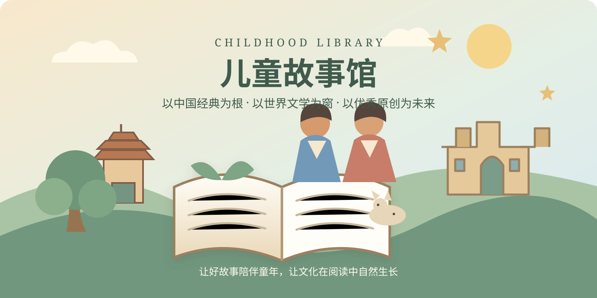
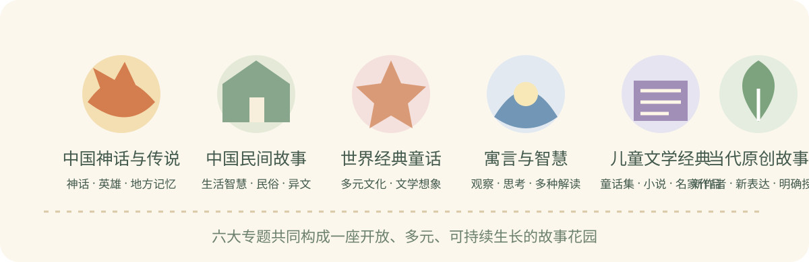
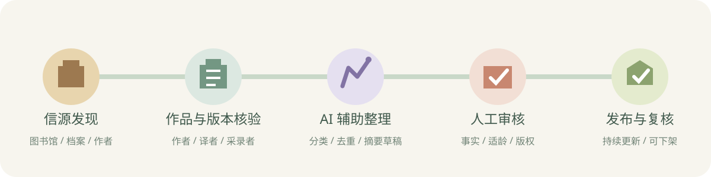

# 儿童故事馆建设方案

> **Childhood Library · Story Library**
>
> 版本：v1.0  
> 文档状态：产品与内容规划基线  
> 更新日期：2026-11-18  
> 定位：以中国经典为根，以世界文学为窗，以优秀原创为未来。

<figure>
  
  <figcaption>图 1｜六大内容专题：从中国神话、民间故事到世界童话、寓言、儿童文学与当代原创。</figcaption>
</figure>

---

## 1. 项目愿景

儿童故事馆不是追求故事数量、流量或快速播放的内容聚合站，而是一座**值得长期整理、阅读、收藏和传承的儿童文学图书馆**。

我们希望孩子能在故事里遇见中国的神话与民间智慧，也能走进世界不同地域的童年；既读到流传已久的经典，也能发现真正尊重儿童、具有文学品质的当代原创。

**核心表达：让好故事陪伴童年，让文化在阅读中自然生长。**

### 1.1 内容定位

- **中国经典为根**：优先挖掘中国神话、民间故事、传统寓言、地方传说与优秀儿童文学。
- **世界经典为窗**：系统整理世界童话、寓言、民间故事和儿童文学，保留作品原生文化语境。
- **优秀原创为未来**：为当代原创绘本、儿童文学和讲述者留出空间，强调作品质量与明确授权。

首期编辑研究精力建议按 **中国 55% / 世界 30% / 优秀原创 15%** 分配。这是资源建设投入比例，不是文学价值排名；后续根据内容质量、来源和授权情况动态调整。

### 1.2 建设原则

1. 文学品质优先于数量，经典价值优先于流量热度。
2. 尊重儿童，不把故事做成密集刺激、说教或知识点灌输。
3. 作品、译本、改编、绘本插画、朗读录音分别建档。
4. 每条内容保留来源、版本、编辑判断和版权证据。
5. AI 可以辅助发现和整理，不能代替编辑判断或决定版权。
6. 阅读体验保持安静、连续、低干扰，不设置打卡、积分和公开评论。

## 2. 故事馆内容地图

建议采用六个一级内容专题。专题可多选，不替代作品类型、地区、语言、作者和时代等基础元数据。

| 一级专题 | 主要内容 | 编辑重点 |
|---|---|---|
| 中国神话与传说 | 创世神话、神仙传说、英雄传说、历史传说 | 区分神话、民间传说与后世文学改写 |
| 中国民间故事 | 民间故事、地方传说、民族故事、生活故事 | 记录地域、讲述者、采录者和异文 |
| 世界经典童话 | 世界各地经典童话、幻想故事、文学童话 | 标明原始版本、改编版本和文化背景 |
| 寓言与智慧 | 中国寓言、伊索寓言及世界寓言传统 | 不把寓意简化成唯一标准答案 |
| 儿童文学经典 | 童话集、儿童小说、中短篇文学作品 | 区分幼儿故事与适合独立阅读的长篇作品 |
| 当代原创故事 | 当代作家、绘本作者、独立创作者作品 | 尊重原创表达，取得清晰授权 |

### 2.1 中国故事优先建设方向

| 子专题 | 研究方向 | 首期候选 |
|---|---|---|
| 上古神话 | 创世、自然、英雄与神祇 | 女娲补天、精卫填海、后羿射日、夸父追日 |
| 民间传说 | 爱情、忠诚、勇气、地方记忆 | 牛郎织女、白蛇传（适龄版本）、梁祝传说 |
| 民间故事 | 生活智慧、善良、机智、想象 | 田螺姑娘、三个和尚、地方故事与民族故事 |
| 中国寓言 | 动物寓言、生活观察、思辨 | 守株待兔、刻舟求剑、狐假虎威、井底之蛙 |
| 中国儿童文学 | 现代儿童文学、童话与小说 | 叶圣陶、张天翼、郑渊洁等作家作品（逐篇核对权利与适龄性） |

候选题材不等于已完成版本考证或取得转载授权。传统故事可能存在多个讲述版本，应避免把某一现代改写误标为唯一原版。

### 2.2 世界故事建设方向

| 地区 / 传统 | 研究方向 | 候选作品或作者 |
|---|---|---|
| 丹麦 | 文学童话 | 安徒生：《丑小鸭》《皇帝的新装》《卖火柴的小女孩》（适龄审慎） |
| 德国 | 民间童话 | 格林童话：《青蛙王子》《糖果屋》等适龄选篇 |
| 英国 | 幻想文学与儿童小说 | 《爱丽丝梦游仙境》《彼得·潘》《柳林风声》 |
| 意大利 | 儿童文学 | 《木偶奇遇记》 |
| 美国 | 儿童幻想文学 | 《绿野仙踪》《夏洛的网》 |
| 法国 | 文学童话 | 夏尔·佩罗童话、《小王子》（阅读年龄与文本版本需区分） |
| 日本 | 童话与儿童文学 | 宫泽贤治作品、经典民间故事 |
| 南亚、非洲、拉美 | 民间故事、动物故事、创世故事 | 优先从当地文化机构、图书馆和可信采录资料发现 |

世界故事不能只等同于欧洲童话。后续应持续补充非洲、南亚、东南亚、拉美、大洋洲及原住民故事传统，并避免用单一故事代表整个国家或民族。

## 3. 年龄分层与阅读方式

年龄分层用于帮助家庭发现内容，不是儿童能力测评，也不是强制阅读门槛。一个故事可以跨多个年龄段，但需要标明推荐理由和文本版本。

| 年龄段 | 阅读重点 | 内容形态 | 产品体验 |
|---|---|---|---|
| 0–2 岁 | 亲子共读、图像感知、声音与节奏 | 简短图画故事、重复句式、生活主题 | 大图、少文字、亲子朗读提示 |
| 2–4 岁 | 情节初识、角色与日常经验 | 短篇故事、动物故事、简单民间故事 | 清晰段落、轻量插图、可选朗读 |
| 4–6 岁 | 想象、情绪理解、因果与角色 | 完整童话、寓言、神话简编 | 故事正文、文化小知识、亲子讨论提示 |
| 6–8 岁 | 独立阅读起步、人物与情节 | 中短篇故事、经典童话、儿童文学 | 章节阅读、词语注释、相关作品 |
| 8–12 岁 | 文学体验、文化理解、多元视角 | 儿童小说、长篇作品、世界文学 | 章节目录、作者背景、版本说明 |

图 2｜年龄分层是内容发现辅助，不是能力测评或硬性门槛；具体推荐仍需结合文本版本人工判断。

### 3.1 适龄审核规则

- 年龄建议要考虑文本长度、语言难度、主题复杂度、情绪强度和版本改写程度。
- 同一作品的原版、节选版、改写版和绘本版可以有不同适龄建议。
- 对死亡、离别、恐惧、冲突等主题不一概回避，但需标注内容特点，避免突兀或猎奇表达。
- 不以“有教育意义”作为唯一收录理由；故事首先应当是好故事。
- 适龄建议由编辑给出依据，AI 只能提供候选建议。

## 4. 作品档案：从“一个故事”到“可追溯版本”

故事馆最重要的数据原则是：**故事题材、文学作品、具体文本版本、绘本版本和朗读资源不是同一个对象。**

例如“丑小鸭”是作品层面的入口；安徒生原作、不同中文译本、儿童改写本、绘本和有声朗读，都应该建立关联而不是混成一条记录。

### 4.1 作品核心字段

| 字段组 | 建议字段 | 说明 |
|---|---|---|
| 身份 | story_id、规范标题、原文标题、别名、slug | 稳定 ID；标题可多语言 |
| 分类 | story_type、genre、themes、collection | 童话、寓言、神话、民间故事、儿童小说等 |
| 文化 | origin_region、country、culture、language | 国家、地区、民族/文化背景和原始语言 |
| 创作者 | author、collector、editor、translator、adapter | 区分作者、采录者、整理者、译者和改编者 |
| 年代 | creation_period、first_publication、collection_date | 不确定时允许为空并说明依据 |
| 内容 | synopsis、story_text、content_version | 简介、正文和具体文本版本分离 |
| 阅读 | age_min、age_max、reading_time、reading_level | 推荐年龄、阅读时长和难度 |
| 编辑 | editorial_note、quality_review、suitability_note | 收录理由、审核说明和适龄依据 |
| 来源 | source_records、source_url、evidence | 书目、档案、采录来源与核验记录 |
| 权利 | rights_status、rights_holder、license、territory | 对作品及每个版本分别记录权利 |

### 4.2 版本关系

- 原作与译本：一部原作可关联多个译本。
- 原作与改编：改编文本应记录改编者及其与原作的关系。
- 文本与绘本：绘本可能包含独立的插画版权和改写文本版权。
- 文本与朗读：朗读音频需独立记录朗读者、录音制作者和授权。
- 民间故事异文：不同地区、讲述者或采录版本应保留差异，不随意合并。

## 5. 故事详情页与阅读体验

### 5.1 故事详情页结构

    ┌──────────────────────────────────────┐
    │ 返回故事馆                收藏 / 加入书架 │
    ├──────────────────────────────────────┤
    │              故事封面插画             │
    │                 丑小鸭                │
    │       安徒生 · 丹麦 · 文学童话          │
    │  适读：4–6 岁 / 6–8 岁   约 8 分钟       │
    ├──────────────────────────────────────┤
    │ 故事简介                              │
    │ 故事正文：舒适行距、清晰段落、可调字号   │
    ├──────────────────────────────────────┤
    │ 关于这个故事：作者、背景、文化语境       │
    │ 亲子共读：可选的开放式讨论提示           │
    │ 相关故事 / 同一作者 / 同一主题           │
    └──────────────────────────────────────┘

这是信息结构示意，不是最终视觉稿。插画、正文和朗读资源应分别显示来源或权利信息；没有合法插画时使用自制图形或纯文字封面，不以抓取图片填充页面。

图 3｜从信源发现到发布复核，AI 只承担辅助整理，事实、适龄与版权均保留人工审核。

### 5.2 阅读器设计原则

1. 以正文为中心：宽松行距、适中行宽、可调字号和清晰段落。
2. 低干扰：不自动播放、不弹出广告式推荐、不使用连续滚动诱导。
3. 版本透明：显示译者、改编者、出版信息和文本版本。
4. 亲子共读提示可选，不把阅读变成答题或作业。
5. 插画服务故事表达，不追求高频动画和刺激效果。
6. 对长篇作品提供章节目录、阅读进度和回到上次位置功能。
7. 支持收藏与个人书架；首期不需要儿童账户、公开评论或社交关系。

## 6. 信源体系：发现、考证与合法使用分开

信源体系建议分五层。**能发现一部作品，不代表可以复制它；能在线阅读，也不代表允许本站转载。**

| 层级 | 信源类型 | 代表入口 | 主要用途 |
|---|---|---|---|
| L1 中国文化与文献档案 | 国家图书馆、公共图书馆、非遗机构、地方志、博物馆 | [中国国家图书馆](https://www.nlc.cn/)、[中国非物质文化遗产网](https://www.ihchina.cn/) | 中国故事源流、地方异文、出版与采录线索 |
| L2 国际数字图书馆 | 公共数字图书馆、历史文献馆藏 | [Project Gutenberg](https://www.gutenberg.org/)、[International Children's Digital Library](http://www.childrenslibrary.org/)、[Library of Congress](https://www.loc.gov/) | 世界儿童文学、历史版本和书目发现 |
| L3 开放许可故事平台 | 明确采用开放许可的内容平台 | [StoryWeaver](https://storyweaver.org.in/) | 多语言故事、绘本与可按许可复用的资源 |
| L4 专业机构与出版体系 | 出版社、作家协会、文学研究机构、奖项与作者官方资料 | 出版社目录、作家官网、文学机构 | 作者、译者、出版版本、作品背景和专业评价 |
| L5 创作者与文化传承人 | 作家、译者、绘本作者、讲述者、地方文化机构 | 官方投稿、合作和授权渠道 | 原创内容、口述故事、授权合作 |

### 6.1 信源使用说明

- Project Gutenberg 的书目适合发现部分历史儿童文学作品，但公版判断必须结合目标发布地区、具体版本和页面权利说明。
- International Children's Digital Library 可用于多语言儿童书籍发现；其馆藏状态和单本使用条件需逐项核实。
- StoryWeaver 提供开放内容，但不同内容类型可能适用不同许可；必须逐本查看署名和许可要求，不能把平台上所有资源概括成同一种授权。
- 中国图书馆、非遗和地方文化机构是研究中国故事的重要入口；数字化展示不自动授予转载权。
- 出版社页面、书评和电商页面可用于发现作品和版本信息，不作为复制正文或插画的授权依据。

图 4｜故事内容必须经过来源、版本、事实、适龄和权利核验后才能公开。

### 6.2 研究工作流

~~~mermaid
flowchart TD
    A[信源发现] --> B[作品身份确认]
    B --> C[版本与作者考证]
    C --> D[元数据标准化]
    D --> E[AI 辅助分类与摘要草稿]
    E --> F[编辑事实核验与适龄审核]
    F --> G[版权逐项核验]
    G --> H{是否具备公开依据}
    H -- 否 --> I[仅内部目录 / 合规外链]
    H -- 是 --> J[人工终审]
    J --> K[发布]
    K --> L[定期复核 / 投诉下架]
~~~

AI 辅助可以包括标题规范化、作者实体匹配候选、主题标签建议、重复记录提示、摘要初稿和缺失字段提示。AI 不得自行补造作者、年代、地域或“原始版本”，也不得自动把版权状态改成可公开。

## 7. 版权与内容安全

故事馆需要细致的权利模型。至少分别核验：原始文学作品、现代译文、改写/缩写/注释、绘本插画/封面/版式、朗读表演和录音制品、相关视频/动画和背景音乐。

### 7.1 建议版权状态

| 状态 | 含义 | 默认展示策略 |
|---|---|---|
| pending | 尚未核验 | 内部审核，不展示受保护正文或媒体 |
| public_domain_verified | 已核实在指定地区属于公版 | 仅按核验范围使用 |
| open_license | 采用开放许可 | 严格遵守署名、衍生、非商业等条件 |
| authorized | 已取得授权 | 按授权地域、用途和期限展示 |
| link_only | 仅允许提供合规来源链接 | 展示必要元数据和外链 |
| restricted | 禁止公开使用 | 不公开相关内容 |
| expired_or_revoked | 授权到期或撤回 | 停止展示，按政策处理资产 |

### 7.2 版权发布门禁

- 作品公版不代表现代译文、改编、插画或朗读录音也公版。
- 版权判断必须记录目标地域、权利人、许可名称、许可链接、用途、署名要求、有效期和证据。
- 对开放许可逐项检查是否允许商业使用、改编、翻译、再分发。
- 不通过 AI 改写、翻译或重新绘图来规避原作品版权。
- 授权不明时，优先只保存必要元数据和合规外链，不复制正文或媒体。
- 收到权利人投诉或授权撤回时，先限制争议内容公开，再记录处理过程。

### 7.3 儿童内容审核

检查故事是否存在明显事实错误、歧视性表达、不适龄恐吓、危险行为模仿风险或对特定文化的刻板描述。对传统故事中的历史观念和旧式表达，应提供必要语境说明，不以无说明的删改替代编辑判断。

## 8. 数据模型建议

项目现有统一模型已包含 works、authors、work_contents、sources、rights_records 等通用实体。故事馆优先复用这些实体，**不应为了故事馆另起一套重复的作品、作者和版权主表**。

建议在通用模型上补充或细化以下概念（最终表名需在数据库迁移前与现有数据模型对齐）：

| 概念 / 表 | 主要职责 |
|---|---|
| literary_work_metadata | 故事专属类型、文化来源、原始语言、年代和文学背景 |
| literary_editions | 出版物、版本、出版社、ISBN、出版日期等书目记录 |
| story_text_versions | 原文、译本、改写本、节选本等文本版本 |
| work_contributors | 复用通用贡献者关系，角色区分作者、采录者、译者、改编者、插画师 |
| illustration_assets | 绘本插画、封面和图像资源；每项关联独立权利记录 |
| narration_resources | 朗读者、音频文件或官方播放链接及其权利状态 |
| cultural_contexts | 地域、民族、语言、采录背景和编辑核验说明 |
| editorial_reviews | 文学质量、适龄、事实和文化审核记录 |

### 8.1 关系示意

~~~mermaid
erDiagram
  WORKS ||--o{ WORK_CONTENTS : has_text_versions
  WORKS ||--o{ WORK_CONTRIBUTORS : credits
  WORKS ||--o{ LITERARY_EDITIONS : published_as
  WORKS ||--o{ ILLUSTRATION_ASSETS : illustrated_by
  WORKS ||--o{ NARRATION_RESOURCES : narrated_as
  WORKS ||--o{ RIGHTS_RECORDS : rights
  WORK_CONTENTS ||--o{ RIGHTS_RECORDS : text_rights
  ILLUSTRATION_ASSETS ||--o{ RIGHTS_RECORDS : image_rights
  NARRATION_RESOURCES ||--o{ RIGHTS_RECORDS : audio_rights
  WORKS }o--o{ COLLECTIONS : curated_into
~~~

这是一张概念关系图，不是可直接执行的数据库 DDL。正式建表前应检查现有通用表的字段与外键，优先扩展而不是重复建设。

## 9. 首批 100 条候选目录

首期目标是建立 **100 条经过初步筛选的故事作品档案**，不是承诺 100 篇正文、插画或音频都可立即公开。

| 内容组 | 目标数量 | 建设重点 |
|---|---:|---|
| 中国神话与传说 | 15 | 上古神话、英雄传说、经典民间传说 |
| 中国民间故事 | 15 | 地方故事、民族故事、生活智慧 |
| 中国寓言 | 10 | 中国古代寓言和民间智慧 |
| 中国儿童文学 | 15 | 现代童话、儿童小说与短篇文学 |
| 世界经典童话 | 15 | 安徒生、格林、佩罗等经典传统 |
| 世界民间故事 | 5 | 非欧洲地区的民间故事 |
| 世界寓言 | 5 | 伊索及其他文化中的寓言传统 |
| 世界儿童文学 | 5 | 世界儿童文学经典 |
| 当代原创 | 15 | 经编辑评审且授权路径清楚的作品 |
| **合计** | **100** | 目录建设目标，非媒体授权数量 |

### 9.1 第一批候选选题（示例）

| 作品 / 题材 | 初步归类 | 后续核验重点 |
|---|---|---|
| 女娲补天 | 中国神话 | 典籍出处、现代讲述版本 |
| 精卫填海 | 中国神话 | 文献出处、改写文本 |
| 后羿射日 | 中国神话 | 不同神话版本与人物关系 |
| 夸父追日 | 中国神话 | 原典与儿童改写差异 |
| 牛郎织女 | 中国传说 | 地方异文、节日文化 |
| 田螺姑娘 | 中国民间故事 | 采录地区与异文 |
| 三个和尚 | 中国故事 / 现代改编 | 传统题材与具体改编作品区分 |
| 守株待兔 | 中国寓言 | 古籍出处、现代注释权利 |
| 刻舟求剑 | 中国寓言 | 原典与释义版本 |
| 狐假虎威 | 中国寓言 | 原典、改写和插画版本 |
| 井底之蛙 | 中国寓言 | 典籍出处和解释多样性 |
| 宝葫芦的秘密 | 中国儿童文学 | 张天翼原作及具体版本权利 |
| 稻草人 | 中国儿童文学 | 叶圣陶原作、版本和插图 |
| 丑小鸭 | 世界文学童话 | 安徒生原作、译本和改写本 |
| 皇帝的新装 | 世界文学童话 | 原作、译文和儿童版本 |
| 青蛙王子 | 世界民间童话 | 格林版本与其他异文 |
| 糖果屋 | 世界民间童话 | 格林版本与适龄处理 |
| 爱丽丝梦游仙境 | 世界儿童文学 | 原作、译本、插画版本 |
| 绿野仙踪 | 世界儿童文学 | 原作、译本与改编作品 |
| 木偶奇遇记 | 世界儿童文学 | 原作、译本、节选和改写 |

上述目录只用于建立研究任务，不代表这些故事的所有译本、绘本和音频均可自由转载。候选故事应继续补充到独立的目录文件，并逐条添加可信来源与版权核验结果。

## 10. 产品模块与页面导航

建议故事馆在童年书房内拥有独立入口，但沿用全站统一的作品、来源、版权和审核能力。

    童年书房
    ├── 故事馆
    │   ├── 故事首页
    │   ├── 中国经典
    │   ├── 世界经典
    │   ├── 寓言与智慧
    │   ├── 儿童文学
    │   ├── 当代原创
    │   ├── 故事详情 / 阅读器
    │   └── 我的书架
    ├── 音乐馆
    ├── 古诗词馆
    └── 内容管理后台
        ├── 故事目录
        ├── 文本与版本
        ├── 作者与贡献者
        ├── 插画与朗读资源
        ├── 信源与采集任务
        ├── 版权审核
        └── 内容质量审核

### 10.1 故事首页

- 今日故事 / 编辑精选：人工策展，不依赖黑箱推荐。
- 中国故事：神话、传说、寓言和民间故事。
- 世界故事：按国家、语言和文化传统探索。
- 按年龄发现：0–2、2–4、4–6、6–8、8–12。
- 按主题发现：自然、勇气、友谊、家庭、想象、成长。
- 最近整理：透明展示新增和更新的作品档案。

### 10.2 搜索与筛选

支持标题、别名、作者、国家/地区、语言、主题、作品类型和年龄建议筛选。默认排序优先编辑精选、经典专题和内容完整度，不用点击量制造热门榜。

## 11. AI 辅助采集与编辑

~~~mermaid
flowchart LR
  A[开放目录 / 官方页面 / 书目] --> B[来源适配器]
  B --> C[原始元数据暂存]
  C --> D[规范化与去重候选]
  D --> E[AI 辅助分类 / 摘要 / 字段提示]
  E --> F[编辑工作台]
  F --> G[事实与适龄审核]
  G --> H[版权证据审核]
  H --> I[发布门禁]
  I --> J[公开故事目录]
~~~

AI 可以做：标题、别名和语言标准化建议；作者、译者和作品实体匹配候选；类型、主题、年龄段分类建议；简介初稿、文化背景摘要草稿；重复记录提示和字段完整性检查。

AI 不可以做：在没有证据时补造作者、年代、国家或民俗来源；自动将未知权利状态改为公版或开放许可；未经许可抓取付费、登录后或禁止自动访问的内容；将受版权保护的故事改写后冒充原创；自动发布未经人工审核的故事正文、插画或音频。

## 12. 建设路线与验收

### S1：故事资源研究与目录（优先启动）

- 建立中国经典与世界经典候选目录。
- 先完成首批 30 条作品的身份、类型、作者/采录者和可信来源核验。
- 形成 100 条候选目录的研究任务池。
- 为每条记录标记版本待确认项和版权状态。
- 暂不批量转载正文、绘本图片或朗读音频。

**验收：** 每条候选有稳定 ID、基础元数据、来源和待核验事项。

### S2：故事档案与合法阅读

- 复用统一作品、作者、来源和版权模型。
- 建立文本版本、译本、改编本和书目关系。
- 实现故事详情页和低干扰阅读器。
- 仅公开权利状态清楚且审核通过的文本。

**验收：** 不同译本和改写本可区分；未审核内容无法从公开接口读取。

### S3：插画与朗读资源

- 接入自制、授权或明确开放许可的插画。
- 建立朗读者、录音版本和官方播放资源档案。
- 评估官方嵌入与站内托管的不同授权要求。
- 媒体资源可独立下架，不影响作品目录。

**验收：** 每个插画、音频和视频资源有独立权利记录与审核状态。

### S4：专题策展与文化扩展

- 建设中国地方故事与民族故事专题。
- 增加世界地区故事专题。
- 与作家、译者、绘本作者和文化机构建立授权合作。
- 建立定期复核、投诉处理和内容更新机制。

**验收：** 专题有编辑说明、来源依据、版本信息和可持续更新责任。

## 13. 与现有项目文档的关系

- PRD：故事馆属于首期文学内容模块，补充故事阅读体验和版本管理要求。
- DATA_MODEL：优先复用统一 works / authors / work_contents / sources / rights_records；故事专属字段以迁移设计补充。
- SOURCE_CATALOG：增加图书馆、数字馆藏、开放故事平台和专业机构的故事资源入口。
- COPYRIGHT_POLICY：沿用作品、译文、插画、朗读音频分别核验的原则。
- INGESTION_DESIGN：故事采集遵循来源适配、暂存、规范化、AI 辅助、人工审核、发布门禁。
- ROADMAP：将故事馆 S1–S4 纳入项目阶段路线。

## 14. 首期明确不做

- 不建设开放投稿社区、评论区、私信或儿童社交关系。
- 不批量抓取商业绘本、付费电子书或音频平台内容。
- 不把搜索结果或在线可读页面当作转载许可。
- 不以自动生成故事充当经典故事的替代品。
- 不以积分、连续打卡、排行榜迫使儿童阅读。
- 不使用未经核验的 AI 内容填充作品史、文化背景或作者资料。

---

> 本文为产品、内容与工程规划文件，不构成法律意见。具体公开、复制、翻译、改编、插画和音频使用，应按目标发布地域、具体版本和实际许可逐项核实。
